<h1 align="center">🕋 Yusr — Hajj Companion Mobile App</h1>

<p align="center">
  The Flutter mobile application of <b>Yusr: Integrated Platform for Hajj Journey Management</b> — B.Sc. Graduation Project at Hadhramout University.
</p>

<p align="center">
  
  
  
  
</p>

<p align="center">
  <a href="#about">About</a> ·
  <a href="#ecosystem">System Ecosystem</a> ·
  <a href="#features">Features</a> ·
  <a href="#screenshots">Screenshots</a> ·
  <a href="#architecture">Architecture</a> ·
  <a href="#tech-stack">Tech Stack</a> ·
  <a href="#getting-started">Getting Started</a>
</p>

---

<a id="about"></a>
## 🕋 About the App

**Yusr Mobile App** is the Android Flutter client of **Yusr: Integrated Platform for Hajj Journey Management**, developed as a B.Sc. Information Technology graduation project at **Hadhramout University** (June 2026).

Hajj campaign operations often suffer from manual procedures, fragmented data, and limited field monitoring. Yusr bridges this gap by unifying administrative campaign management with an intelligent mobile companion that serves **Pilgrims**, **Field Supervisors**, **Campaign Managers**, and **Guests**. From real-time GPS & Bluetooth group safety monitoring ("Be a Leader") and lost-pilgrim navigation ("Return Me") to sensor-driven automatic Tawaf & Sa'i counting and a grounded RAG AI Islamic Q&A assistant ("Smart Mufti"), the app delivers an organized, safe, and facilitated Hajj experience.

<a id="ecosystem"></a>
## 🌐 System Ecosystem

This repository contains the **Flutter Mobile Application** within the complete multi-component Yusr platform:

| Component | Technology | Role & Access |
| :--- | :--- | :--- |
| **Mobile Application** *(This Repo)* | Flutter, Dart, Riverpod | Field companion for Pilgrims, Supervisors, Campaign Managers, and Guests |
| **Public Registration Website** | ASP.NET Core MVC (.NET 8) + Azure AI Document Intelligence | Electronic Hajj registration & passport scanning — [yusrwebsite.runasp.net](https://yusrwebsite.runasp.net) |
| **Admin & Manager Web Dashboard** | ASP.NET Core MVC (.NET 8) | Agency, campaign, group, and analytical report management — [yusrwebdashborde.runasp.net](https://yusrwebdashborde.runasp.net) |
| **Backend REST API** | ASP.NET Core Web API (.NET 8), SQL Server, JWT, FCM | Core business logic & data layer — [yusrapp.runasp.net](http://yusrapp.runasp.net/index.html) |
| **Smart Mufti AI Engine** | FastAPI, `BAAI/bge-m3`, Qdrant Cloud, Gemini 2.5 Flash | Cloud-hosted RAG pipeline for grounded Arabic Hajj & Umrah rulings |

<a id="features"></a>
## ✨ Key Features

- 🔐 **Role-Based Authentication & Access** — Login via email or passport number with password recovery, dynamically adapting the navigation drawer and screens for **Pilgrims**, **Supervisors**, **Campaign Managers**, and **Guests**.
- 🧭 **Be a Leader (Live Field Monitoring)** — Enables Supervisors to activate real-time group tracking with pilgrim consent, displaying color-coded safe zones on OpenStreetMap, confirming close proximity via Bluetooth beacons, and triggering alerts when a pilgrim leaves the safe perimeter.
- 📍 **Return Me (Campaign Navigation)** — Guides lost pilgrims directly back to the campaign's current lodging/base location using interactive OpenStreetMap routing.
- ⏱️ **Automatic Tawaf & Sa'i Counter** — Uses smartphone IMU sensors (Gyroscope, Accelerometer, Pedometer) and GPS with filtering algorithms to automatically count ritual laps, complete with haptic vibration, audio alerts upon completion, and manual correction controls.
- 🤖 **Smart Mufti (AI Religious Assistant)** — Connects to a decoupled RAG pipeline (`BAAI/bge-m3` embeddings + Qdrant vector search + `gemini-2.5-flash` with strict similarity thresholding) to provide grounded, citation-backed Arabic rulings on Hajj and Umrah without AI hallucinations.
- 📖 **Structured Hajj Rituals Guide** — Offline-ready step-by-step guidance organized by Hajj type (**Ifrad**, **Qiran**, **Tamattu'**) and day-by-day rituals & supplications.
- 📢 **Targeted Announcements & Push Notifications** — Real-time broadcasts from Campaign Managers and Supervisors to all pilgrims, supervisors, or specific groups via Firebase Cloud Messaging (FCM).
- 🏕️ **Campaign, Group & Base Location Management** — Allows Managers to inspect campaign statistics and set/update lodging coordinates on the map, while Supervisors and Pilgrims can view group details and health indicators.
- 👤 **Personal Profile Management** — View personal and campaign details and update Saudi/Yemeni/WhatsApp contact numbers seamlessly.

<a id="screenshots"></a>
## 📱 Screenshots

A look at the main mobile interfaces across Pilgrim, Supervisor, and Campaign Manager roles:

<table>
  <tr>
    <td align="center" width="33%">
      <a href="screenshots/drawer_navigation.jpg">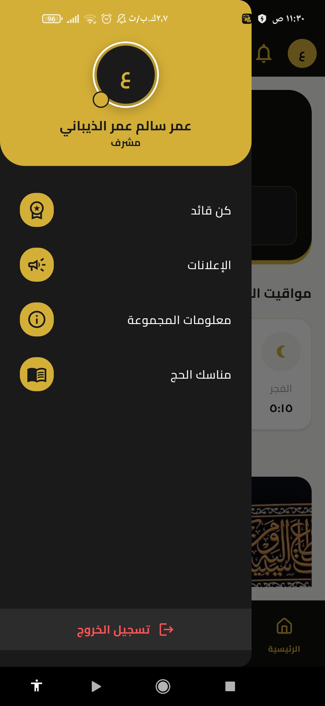</a>
      <br /><b>Role-Based Navigation</b>
    </td>
    <td align="center" width="33%">
      <a href="screenshots/smart_mufti_1.jpg">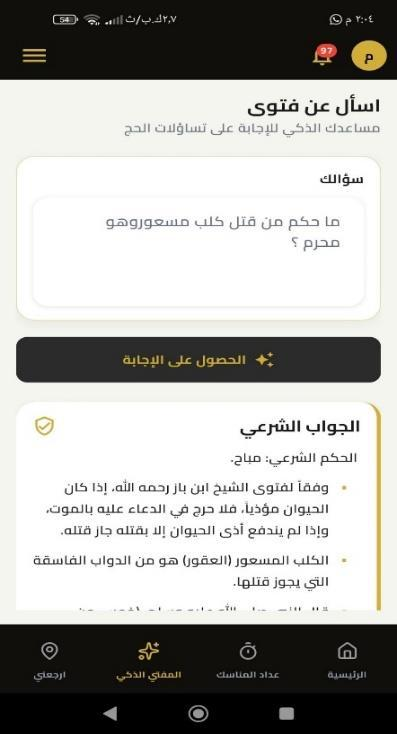</a>
      <br /><b>Smart Mufti (RAG AI)</b>
    </td>
    <td align="center" width="33%">
      <a href="screenshots/auto_counter.jpg">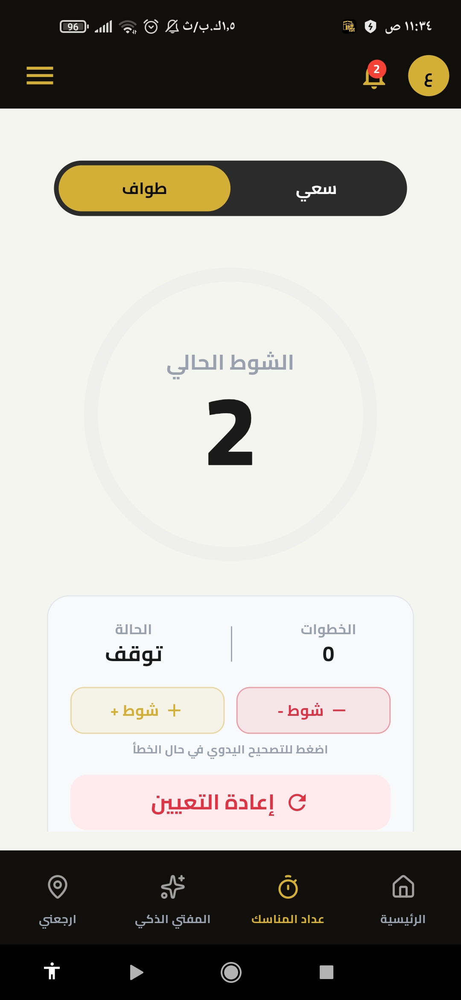</a>
      <br /><b>Automatic Ritual Counter</b>
    </td>
  </tr>
  <tr>
    <td align="center" width="33%">
      <a href="screenshots/be_a_leader_1.jpg">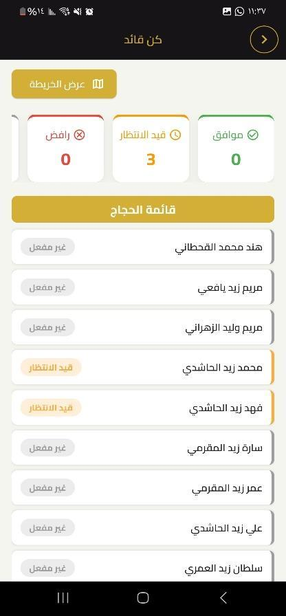</a>
      <br /><b>Be a Leader — Pilgrims Status</b>
    </td>
    <td align="center" width="33%">
      <a href="screenshots/be_a_leader_2.jpg">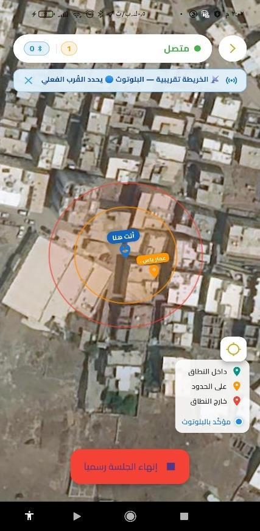</a>
      <br /><b>Be a Leader — Live Safe Zones</b>
    </td>
    <td align="center" width="33%">
      <a href="screenshots/be_a_leader_3.jpg">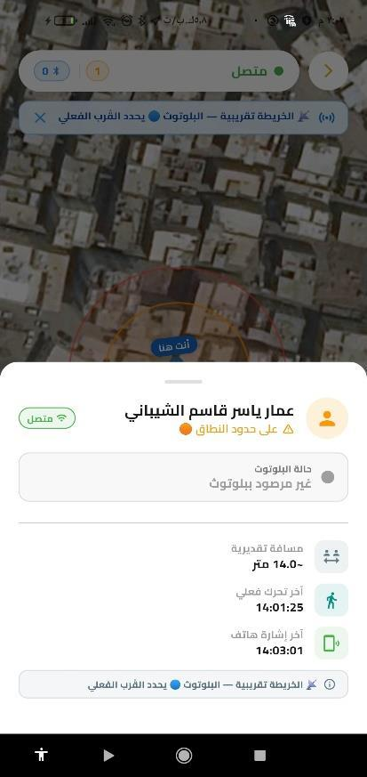</a>
      <br /><b>Be a Leader — Proximity & Telemetry</b>
    </td>
  </tr>
  <tr>
    <td align="center" width="33%">
      <a href="screenshots/return_me.jpg">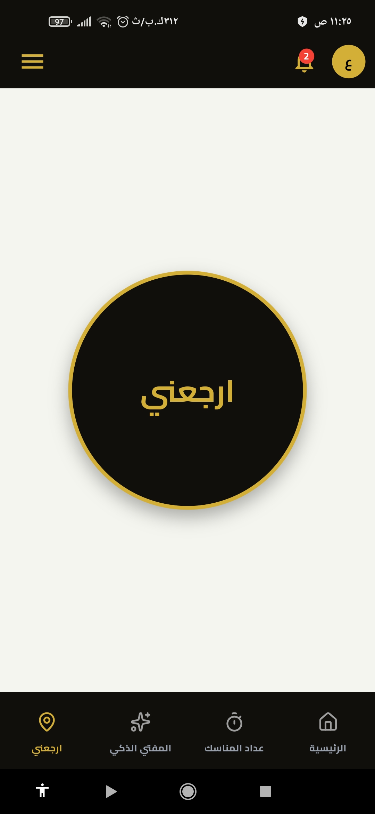</a>
      <br /><b>Return Me</b>
    </td>
    <td align="center" width="33%">
      <a href="screenshots/campaign_base_location.jpg">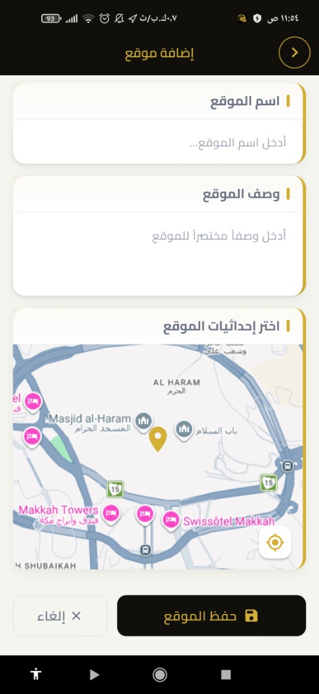</a>
      <br /><b>Set Campaign Base Location</b>
    </td>
    <td align="center" width="33%">
      <a href="screenshots/hajj_types.jpg">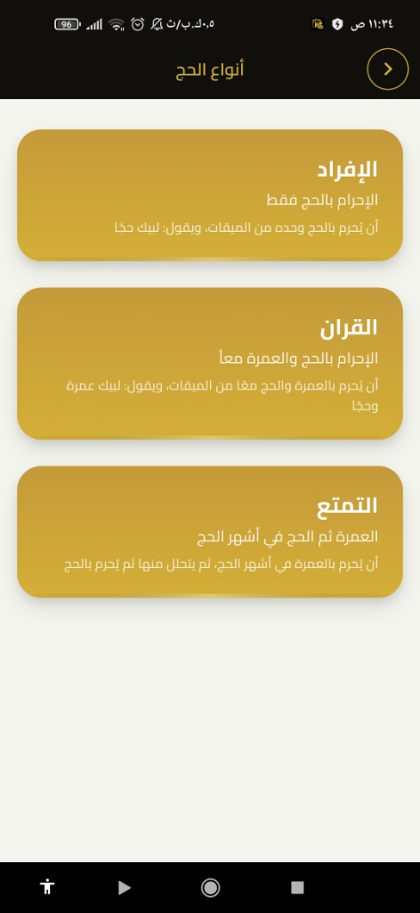</a>
      <br /><b>Hajj Rituals — Types</b>
    </td>
  </tr>
  <tr>
    <td align="center" width="33%">
      <a href="screenshots/ritual_guidelines.jpg">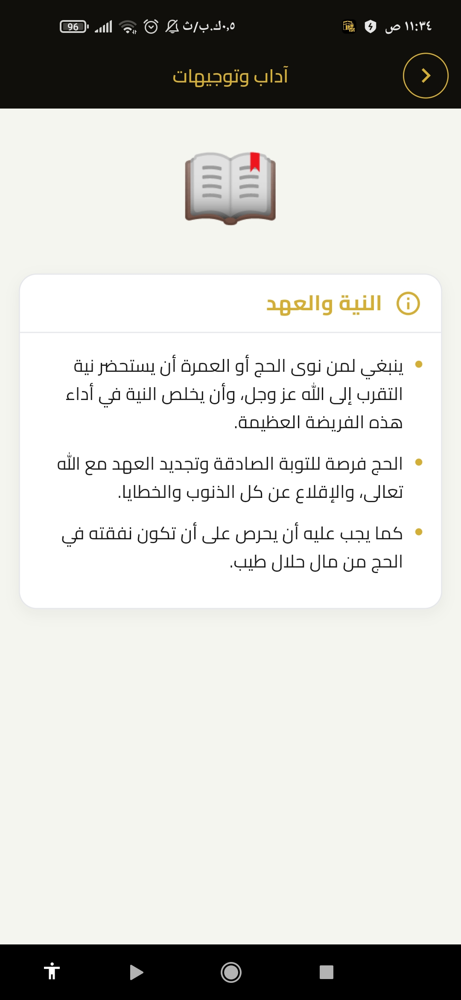</a>
      <br /><b>Ritual Etiquette & Guidelines</b>
    </td>
    <td align="center" width="33%">
      <a href="screenshots/campaign_overview.jpg">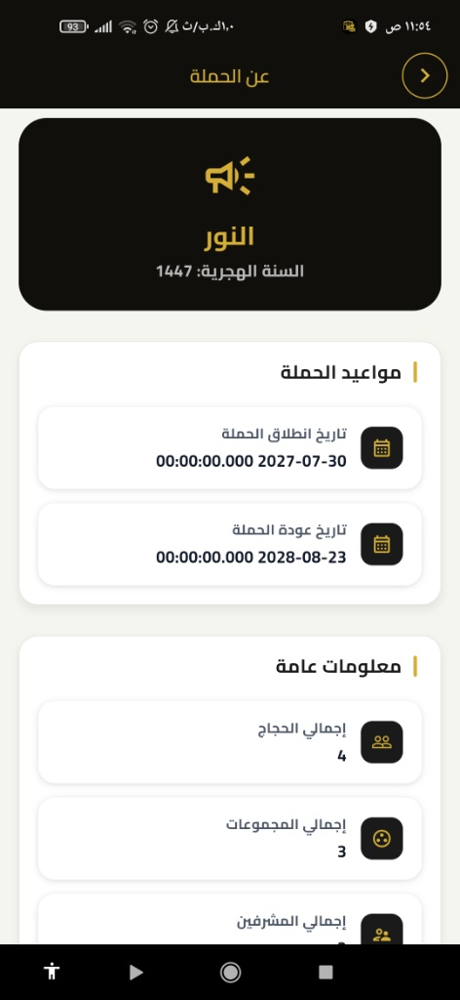</a>
      <br /><b>Campaign Overview</b>
    </td>
    <td align="center" width="33%">
      <a href="screenshots/group_details.jpg">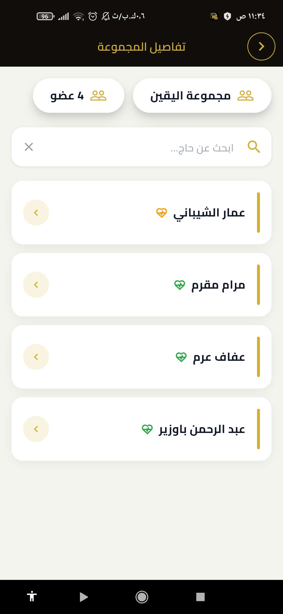</a>
      <br /><b>Group Details & Members</b>
    </td>
  </tr>
</table>

<a id="architecture"></a>
## 🏛️ App Architecture

The mobile app follows a **Feature-First Clean Architecture** pattern. Shared utilities, theme configuration, networking, and core services live inside `core/`, while each domain feature is organized as a self-contained module with its own models, repositories, Riverpod state providers (with code generation), and UI screens.

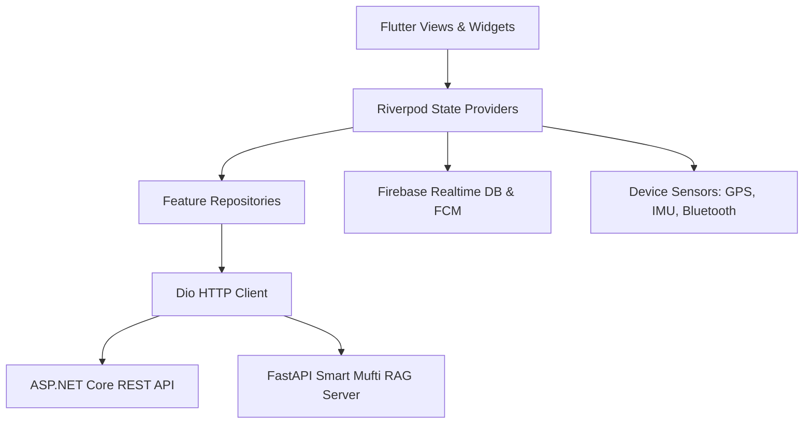

### Project Structure

```text
lib/
├── main.dart                     # App entry point, Firebase & Riverpod setup
├── core/                         # Shared constants, themes, Dio client, services & utilities
└── features/                     # Self-contained feature modules (models, repositories, providers, views)
    ├── auth/                     # Login, password recovery & role session handling
    ├── home/                     # Role-adaptive home screen & navigation drawer
    ├── be_a_leader/              # Live GPS & Bluetooth group monitoring sessions
    ├── return_me/                # Lost-pilgrim navigation to campaign base location
    ├── auto_counter/             # Sensor-based automatic Tawaf & Sa'i lap counter
    ├── smart_mufti/              # AI-powered Arabic Islamic Q&A interface
    ├── hajj_rituals/             # Structured Hajj types & day-by-day ritual guide
    ├── announcements/            # Broadcast announcements & FCM notifications
    ├── campaign_groups/          # Campaign overview, groups & base location management
    └── profile/                  # User profile & contact management
```

<a id="tech-stack"></a>
## 🛠️ Tech Stack

| Purpose | Technology |
| :--- | :--- |
| **UI & Language** | Flutter, Dart (Android) |
| **State Management** | Riverpod (with code generation) |
| **Networking** | Dio (RESTful API integration) |
| **Real-Time Sync & Notifications** | Firebase Core, Firebase Realtime Database, Firebase Cloud Messaging (FCM) |
| **Maps & Geolocation** | Flutter Map, OpenStreetMap, LatLong2, Geolocator |
| **Hardware & Motion Sensors** | Sensors Plus (Gyroscope/Accelerometer), Pedometer, Flutter Blue Plus, Beacon Broadcast, Vibration, Audioplayers, Wakelock Plus |
| **Backend & Database** | ASP.NET Core Web API (.NET 8), Microsoft SQL Server, JWT Auth |
| **AI Smart Mufti Engine** | FastAPI (Hugging Face Spaces), `BAAI/bge-m3`, Qdrant Cloud, Google GenAI (`gemini-2.5-flash`) |

Package versions are listed in [pubspec.yaml](pubspec.yaml).

<a id="getting-started"></a>
## 🚀 Getting Started

### Prerequisites

- **Flutter SDK** and **Dart** installed (`flutter doctor` passing).
- **Android Studio** or **VS Code** with Flutter/Dart extensions.
- A **physical Android device** (recommended for testing real GPS, Gyroscope, Pedometer, Vibration, and Bluetooth sensors).
- Active internet connection for Backend API, Firebase, OpenStreetMap tiles, and Smart Mufti AI requests.

### Run Locally

```bash
git clone [https://github.com/ReemMohsn/yusr_app.git](https://github.com/ReemMohsn/yusr_app.git)
cd yusr_app
flutter pub get
flutter run
```

Ensure Firebase configuration (`google-services.json`) and backend base URLs are properly configured before building for release.

## 👩‍💻 Authors & Academic Context

Developed as a B.Sc. Graduation Project at the **Department of Information Technology, College of Computer Science & Information Technology, Hadhramout University** (June 2026) under the supervision of **Dr. Hassan A. Mogaibel**.

- **[Reem Mohsen](https://github.com/ReemMohsn)** — Flutter Mobile App Developer & System Analyst
- **Team Members:** Asma Mohammad Ali Shammakh, Khulood Abdulrahman Mohammed Makarem, Shaikhah Sami Awad Masjedi, Mariam Abdulrahman Omar Al-Shair, and Manar Abdullah Mohammed Bawazeer.
